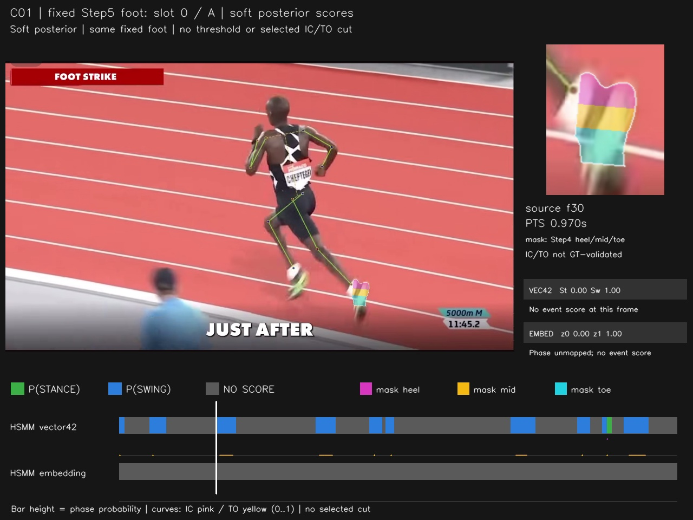
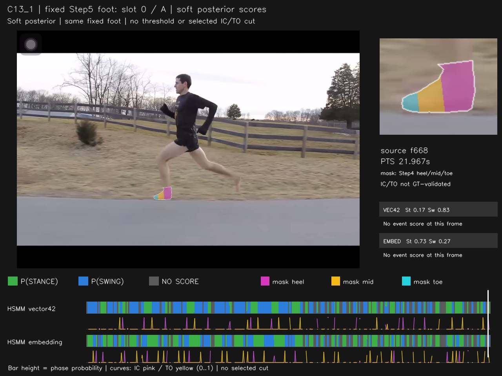
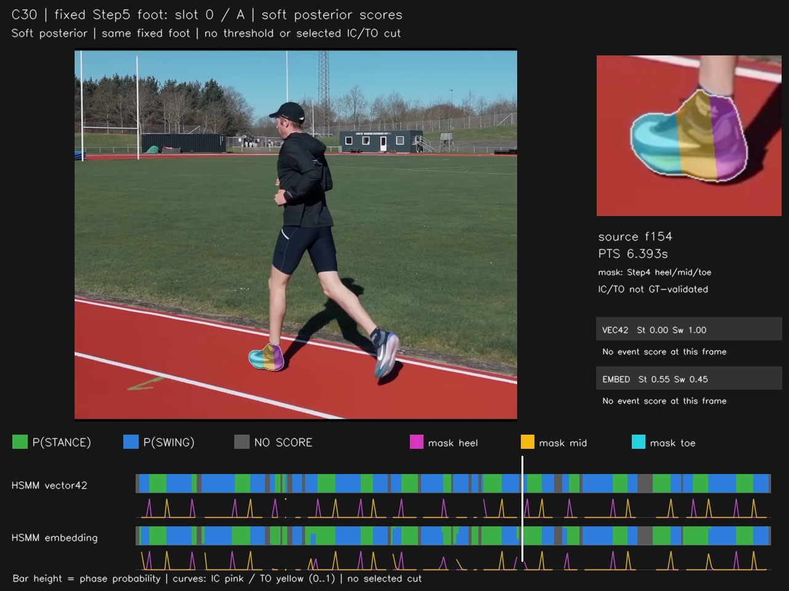
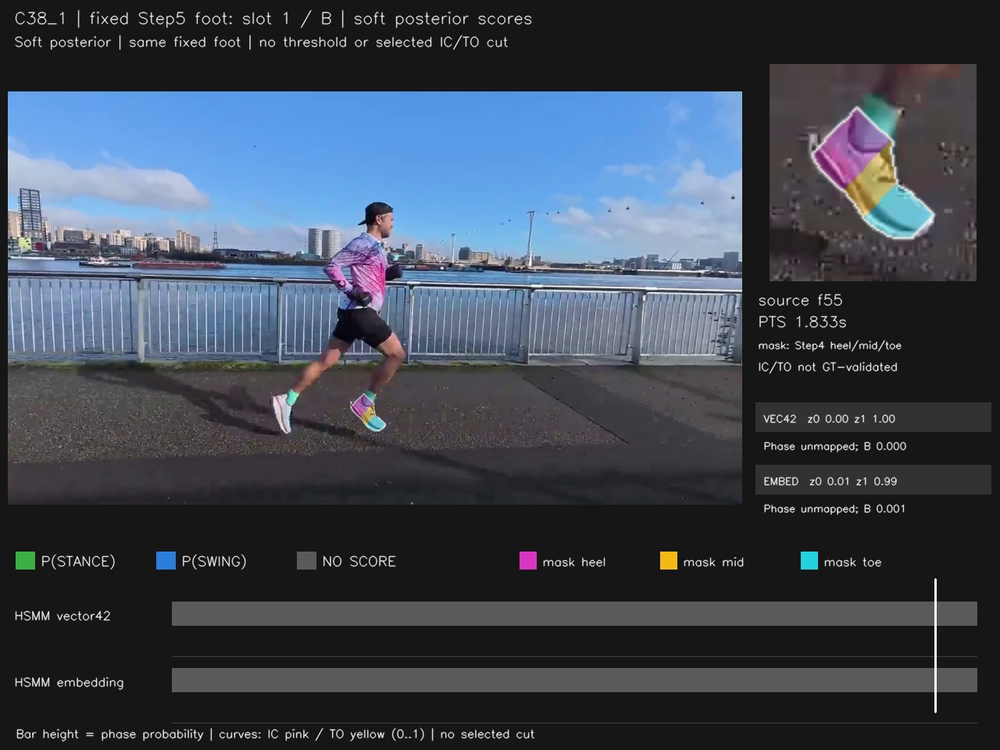

# HSMM: vector 42 chiều và embedding optical flow

Đầu ra chính là soft posterior theo frame: P(stance), P(swing), P(IC), P(TO), P(latent boundary) và entropy. Video hiển thị xác suất, không chọn điểm cắt hay áp threshold. Thí nghiệm tự học theo video; chưa có ground truth.

Bảng event/segment dưới đây chỉ là chẩn đoán Viterbi/MAP được giữ để đối chiếu, không phải quyết định của đầu ra xác suất.

| Video | Input | Trạng thái | N hợp lệ | IC MAP | TO MAP | UNKNOWN boundaries | Đoạn MAP <0.167s |
|---|---|---|---:|---:|---:|---:|---:|
| C01 | vector42 (42D) | exploratory_cv | 38 | 1 | 0 | 2 | 13 |
| C01 | embedding (42D) | phase_unidentified | 38 | 0 | 0 | 6 | 16 |
| C13_1 | vector42 (42D) | validated_cv | 500 | 18 | 13 | 40 | 106 |
| C13_1 | embedding (42D) | exploratory_cv | 500 | 14 | 34 | 31 | 123 |
| C30 | vector42 (42D) | exploratory_cv | 228 | 14 | 11 | 16 | 38 |
| C30 | embedding (42D) | exploratory_cv | 228 | 12 | 15 | 16 | 39 |
| C38_1 | vector42 (42D) | phase_unidentified | 51 | 0 | 0 | 7 | 7 |
| C38_1 | embedding (42D) | phase_unidentified | 51 | 0 | 0 | 5 | 6 |

## Đối chiếu hai nhánh

| Video | Quan sát cả hai đã gán pha | Tỷ lệ bất đồng pha | F1 khớp latent boundaries |
|---|---:|---:|---:|
| C01 | 0 | Không đánh giá | 0.444 |
| C13_1 | 491 | 58.0% | 0.547 |
| C30 | 225 | 9.8% | 0.929 |
| C38_1 | 0 | Không đánh giá | 0.667 |

Agreement là mức hai mô hình giống nhau, không phải mức đúng. F1 ở đây xét mọi latent boundary, bao gồm boundary UNKNOWN/cùng pha; có thể khác 0 ngay cả khi không có IC/TO. Tỷ lệ bất đồng chỉ tính nơi cả hai đã gán pha; UNKNOWN không được coi là đồng thuận sinh cơ học.

Vector dễ truy nguyên từng đặc trưng và nhóm vùng; embedding mô tả phân bố vị trí–flow linh hoạt hơn nhưng phụ thuộc bandwidth, số chiều và seed RFF. Chưa có cơ sở chọn hướng thắng chỉ từ các số nội bộ; cần xem các đoạn bất đồng và bổ sung nhãn kiểm tra.

## Xem trực quan

- C01 · [IC/TO theo frame gốc](C01/event_confidence.png) · [CSV confidence](C01/event_confidence_frames.csv)
- [C01: video posterior](C01/C01_hsmm_probabilities.mp4) | [CSV từng frame](C01/probabilities_frames.csv) | [biểu đồ score](C01/probability_scores.png)
  
- C13_1 · [IC/TO theo frame gốc](C13_1/event_confidence.png) · [CSV confidence](C13_1/event_confidence_frames.csv)
- [C13_1: video posterior](C13_1/C13_1_hsmm_probabilities.mp4) | [CSV từng frame](C13_1/probabilities_frames.csv) | [biểu đồ score](C13_1/probability_scores.png)
  
- C30 · [IC/TO theo frame gốc](C30/event_confidence.png) · [CSV confidence](C30/event_confidence_frames.csv)
- [C30: video posterior](C30/C30_hsmm_probabilities.mp4) | [CSV từng frame](C30/probabilities_frames.csv) | [biểu đồ score](C30/probability_scores.png)
  
- C38_1 · [IC/TO theo frame gốc](C38_1/event_confidence.png) · [CSV confidence](C38_1/event_confidence_frames.csv)
- [C38_1: video posterior](C38_1/C38_1_hsmm_probabilities.mp4) | [CSV từng frame](C38_1/probabilities_frames.csv) | [biểu đồ score](C38_1/probability_scores.png)
  

## Xác suất theo frame

Đầu ra confidence IC/TO gồm event_confidence_frames.csv và event_confidence.png. Mỗi frame gốc có hai điểm số từ 0 đến 1 cho từng nhánh. Khoảng xám và cờ flow_supported=False biểu thị thiếu bằng chứng chuyển trạng thái. Giá trị 0 tại đó là mức hỗ trợ bằng 0.

Hướng stance/swing dựa trên độ tương phản của tỷ lệ pixel chậm, lấy trung bình heel/mid/toe. Bootstrap theo khối thời gian đo mức ổn định của hai cách gán trạng thái, rồi dùng mức hỗ trợ làm trọng số cho hai xác suất chuyển trạng thái HSMM. Confidence giảm khi tương phản pha yếu. Một boundary giữa hai quan sát cách nhau nhiều frame chia đều phần hỗ trợ trên các frame đủ điều kiện trong khoảng đó. Đây là score chưa hiệu chuẩn.

Các mục posterior dưới đây là chẩn đoán của cách gán pha trước đó.

Mỗi nhánh có probabilities_observations.csv (cặp flow unique) và probabilities_frames.csv (toàn bộ frame gốc). Root mỗi video có CSV ghép hai nhánh. P(phase) là marginal posterior cộng qua các đường phân đoạn, không lấy từ nhãn Viterbi. Xác suất có điều kiện theo toàn bộ run quan sát và model đã fit; đây là smoothing offline, không phải dự đoán realtime.

Phase posterior được giữ trong khoảng frame mà quan sát flow đại diện. Event posterior chỉ có tại frame boundary giữa hai quan sát liên tục; không lặp event score sang frame trùng/intermediate. Run start, gap, frame cuối, freeze/card hoặc không đủ dữ liệu có score NaN với cờ available=False. Không tự chuyển NaN thành 0.

P(IC)+P(TO) có thể nhỏ hơn P(latent boundary), vì HSMM cho phép boundary/reset cùng pha. Khi chưa ánh xạ được hai pha, p_stance/p_swing/p_IC/p_TO là NaN; p_state_k và latent boundary vẫn có thể hữu ích. UNKNOWN không phải lớp xác suất thứ ba.

Video: tỷ lệ chiều cao xanh lá/xanh dương biểu diễn P(stance)/P(swing); đồ thị nhỏ phía dưới là P(IC) hồng và P(TO) vàng. Xám là chưa có score. Không có đường cắt IC/TO được chọn. Entropy đo mức phân tán posterior latent của model hiện tại; không bao gồm đầy đủ bất định tham số/giữa seed. Score gần 1 không chứng minh đúng sinh cơ học khi chưa có calibration bằng ground truth.

## Cách đọc kết quả

Hai nhánh dùng cùng chân cố định, frame/cặp flow và pixel vượt kiểm tra forward–backward trong heel/mid/toe. Cặp chỉ được dùng nếu cả ba vùng có ít nhất 10 pixel và trục bàn chân hợp lệ. Các sample cũ không bị ghi đè.

Vector: 14 đặc trưng/vùng = 42D. Embedding: RFF của [xi, eta, signedlog(vx), signedlog(vy)] rồi lấy trung bình trong từng vùng, nối ba vùng; mặc định 14D/vùng = 42D để khớp số chiều. Đây là embedding hữu hạn, không giữ nguyên mọi thông tin pixel.

Cả hai dùng robust scaling và covariance tổng của đặc trưng chỉ trên train, shrinkage về diagonal, whitening khả nghịch không giảm chiều. Đây KHÔNG phải covariance phần dư latent hay multi-output GP được học đồng thời. Phân bố Gaussian sau biến đổi tương đương covariance đầy đủ trong không gian đặc trưng trước whitening; không bảo đảm độc lập thật hay posterior đã calibrated.

Chọn hyperparameters trong từng nhánh bằng CV likelihood, ưu tiên fold nhận diện được cả hai chế độ contact. Cùng grid penalty {0,0.5,1}, noise variance {0.25,0.5}, duration 0.08–0.75s, RFF thời gian 12. Các seed final không phân biệt được hai pha bị loại; tất cả thất bại thì phase UNKNOWN. Tham số duration cố định là giả định cần kiểm tra tiếp.

NLL của vector và embedding thuộc hai không gian quan sát khác nhau: KHÔNG dùng để xếp hạng hai hướng. Cùng số chiều cũng không làm hai mật độ tương đương. Các số IC/TO, agreement, độ ổn định seed và đoạn ngắn là chỉ số chẩn đoán, không phải accuracy. Đoạn <0.167s có thể là endpoint bị censor hoặc reset cùng pha; không tự động là lỗi.

Stance/swing vẫn là diễn giải dựa trên slow ratio (ngưỡng 2 L_leg/s) của các latent classes; IC/TO là ứng viên từ chuyển pha. Chưa có kiểm chứng sinh cơ học bằng nhãn thật. validated_cv chỉ nói về tiêu chí nội bộ; exploratory_cv chỉ có bằng chứng chưa đầy đủ.

Nếu không đủ ba nhóm run độc lập, CV dùng các block thời gian rời nhau, không có gap và được đánh dấu exploratory. Đây là kiểm tra nội bộ video, không phải khả năng tổng quát hóa sang người/video khác.

Quy ước tập con rỗng: C=S=0 khi không có pixel speed>0.2; slow_centroid=0 khi không có pixel speed<2, đi kèm slow_2=0. Mask/vùng thiếu không được điền flow=0 mà bị loại khỏi cả hai nhánh.

Đề xuất chọn hướng sau khi xem boundary bất đồng trên video và bổ sung nhãn kiểm tra nhỏ; không chọn chỉ vì nhánh tạo ít/many events hơn.
